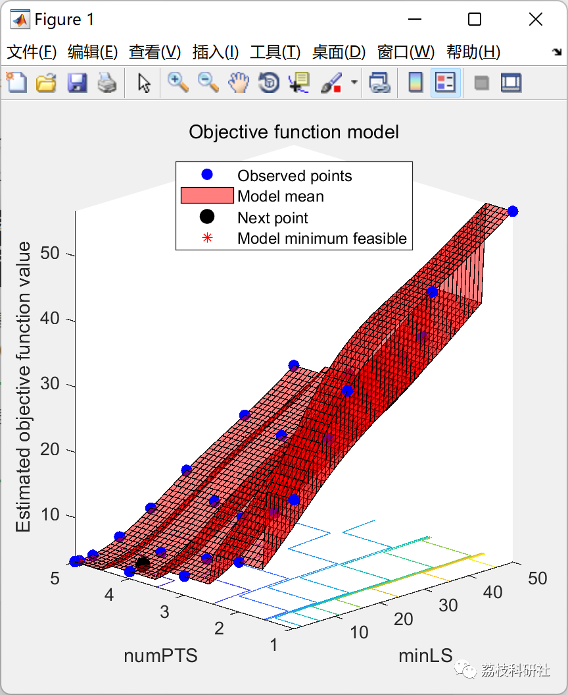
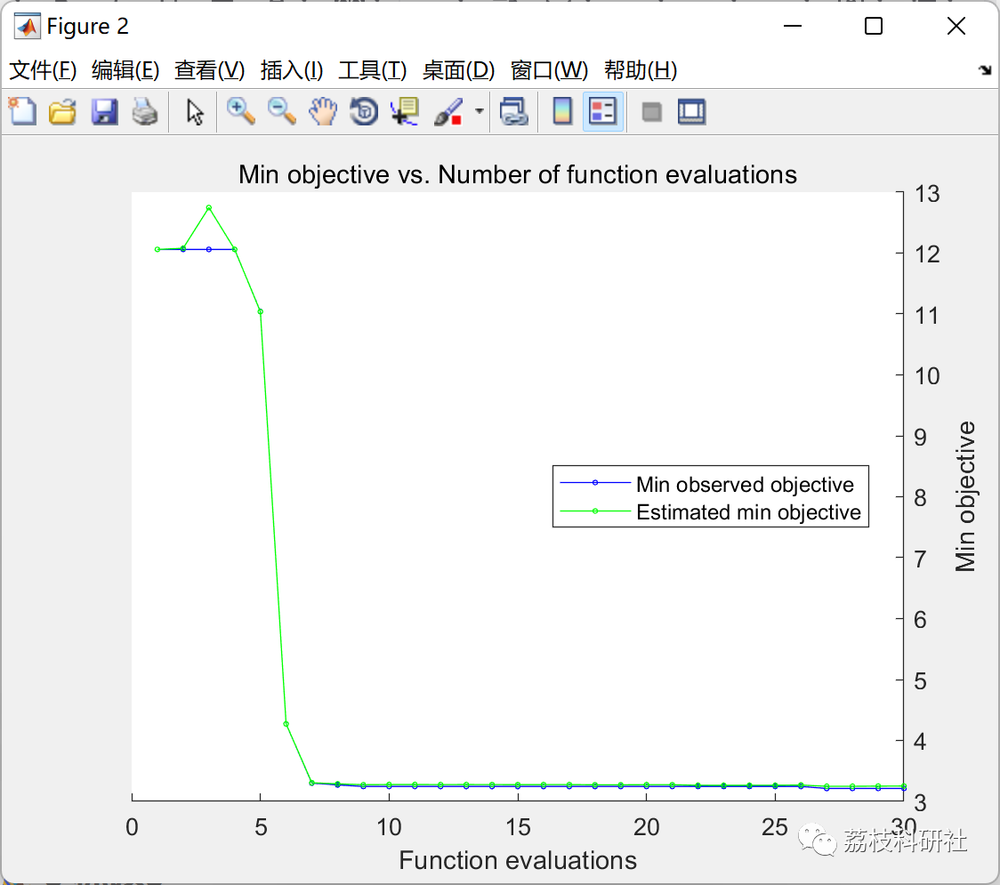
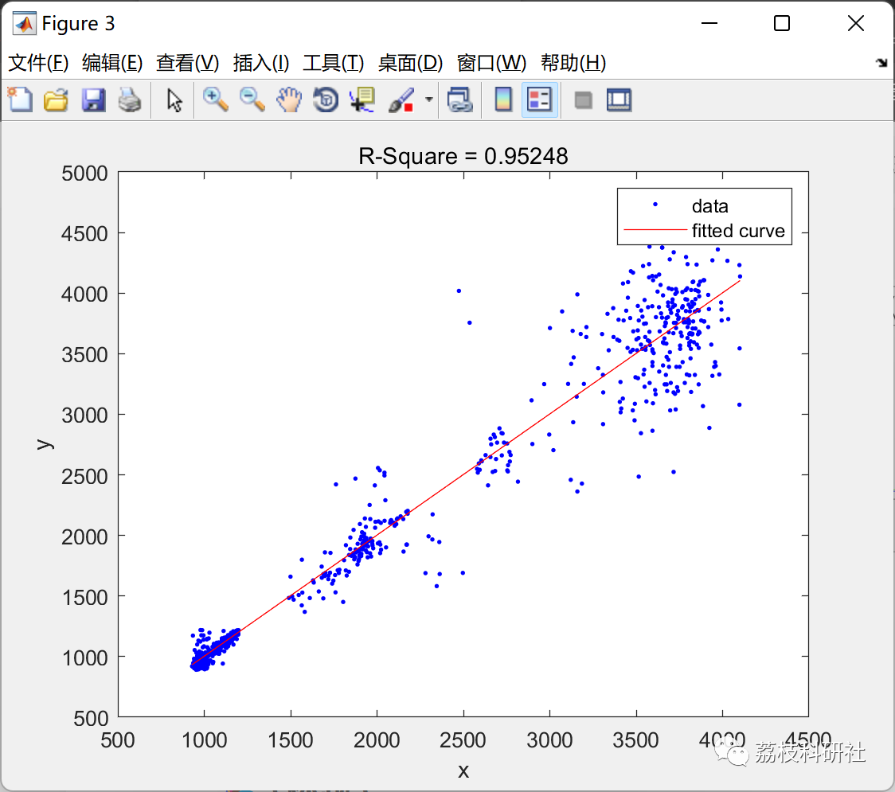
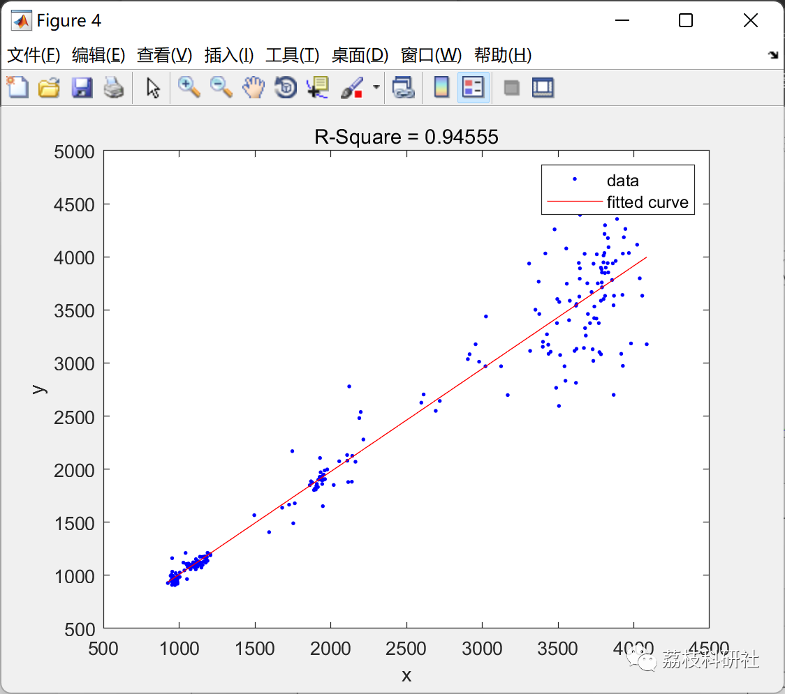
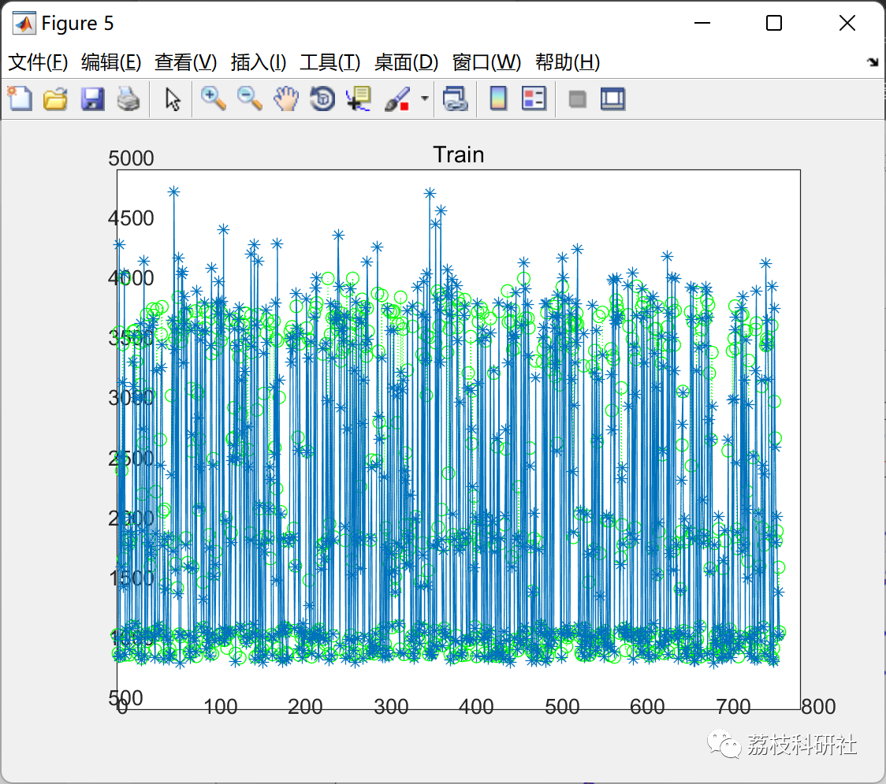
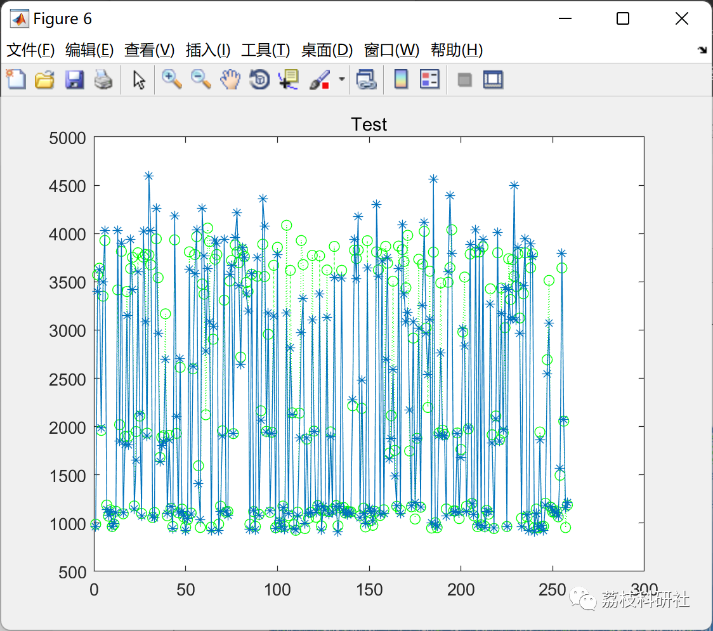
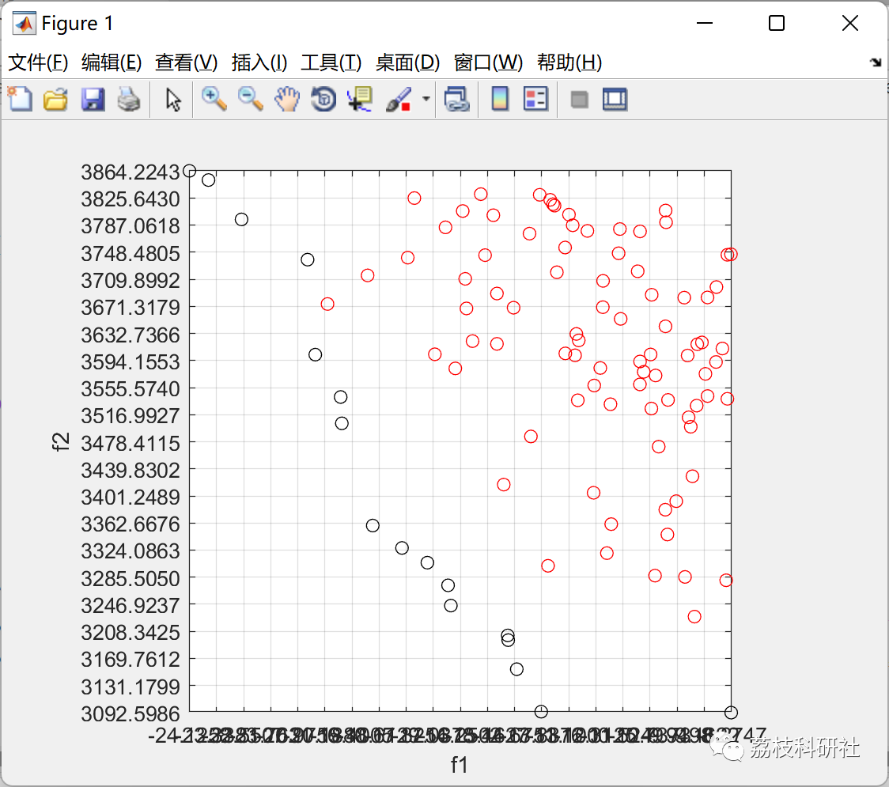

# "Random Forest" and "Hybrid Random Forest with Multi-Objective Particle Swarm Optimization" (RF_MOPSO) as learning methods to predict targets, respectively finding the best parameters for multi-feature processes.

💥💥💥💞💞💞💞 Welcome to this blog❤️❤️❤️💥💥💥
🏆 Bloggers' Advantage: 🌞🌞🌞 The content of the blog strives to be rigorous in thought and clear in logic, for the convenience of readers.
⛳️ Mantra: The journey of a hundred miles is half done in the last ninety.
Litchi Research Society
Code Collection: Power System, Intelligent Algorithms and Applications, Neural Network Prediction, Path Planning, Optimized Scheduling, Workshop Scheduling, Image Processing, Signal Processing...
🎁Column Directory Link:
🌈🌈🌈🌟🌟🌟🛫🛫🛫🛫🛫🛫🛫🛫🛫🛫🛫🛫🛫🛫🛫🛫🛫🛫🛫🛫🛫🛫🛫🛫🛫🛫🛫🛫🛫🛫🛫🛫🛫🛫🛫🛫🛫🛫🛫🛫🛫🛫🛫🛫🛫🛫🛫🛫🛫🛫🛫🛫🛫🛫🛫🛫🛫🛫🛫🛫🛫🛫🛫🛫🛫🛫🛫🛫🛫🛫🛫🛫🛫🛫🛫🛫🛫🛫🛫🛫🛫🛫🛫🛫🛫🛫🛫🛫🛫🛫🛫🛫🛫🛫🛫🛫🛫🛫🛫🛫🛫🛫🛫🛫🛫🛫🛫🛫🛫🛫🛫🛫🛫🛫🛫🛫🛫🛫🛫🛫🛫🛫🛫🛫🛫🛫🛫🛫🛫🛫🛫🛫🛫🛫🛫🛫🛫🛫🛫🛫🛫🛫🛫🛫🛫🛫🛫🛫🛫🛫🛫🛫🛫🛫🛫🛫🛫🛫🛫🛫🛫🛫🛫🛫🛫🛫🛫🛫🛫🛫🛫🛫🛫🛫🛫🛫🛫🛫🛫🛫🛫🛫🛫🛫🛫🛫🛫🛫🛫🛫🛫🛫🛫🛫🛫🛫🛫🛫🛫🛫🛫🛫🛫🛫🛫🛫🛫🛫🛫🛫🛫🛫🛫🛫🛫🛫🛫🛫🛫🛫🛫🛫🛫🛫🛫🛫🛫🛫🛫🛫🛫🛫🛫🛫🛫🛫🛫🛫🛫🛫🛫🛫🛫🛫🛫🛫🛫🛫🛫🛫🛫🛫🛫🛫🛫🛫
💥1 Overview
Multi-objective optimization problems are generally involved in the fields of engineering design, manufacturing production, and information processing. The Particle Swarm Optimization Algorithm has the characteristics of fast convergence, simplicity and easy implementation, and parallel search, which is particularly suitable for solving multi-objective optimization problems. This paper systematically studies the multi-objective particle swarm optimization algorithm, combining the advantages of random forest. Including "Random Forest" and "Mixed Random Forest with Multi-Objective Particle Swarm Optimization" (RF_MOPSO), which uses the prediction of targets as learning methods to respectively find the optimal parameters for multi-feature processes. One example is the prediction and optimization of drilling process. The method of combining the random forest with multi-objective particle swarm optimization algorithm is used to assist in optimizing the selection of process parameters.
📚2 Running Results
📃2.1 Example 1
📃2.2 Example 2
🎉3 References
[1] Yin Dan. Improvement and Application of Multi-Objective Particle Swarm Optimization Algorithm [D]. Yangzhou University, 2021. DOI: 10.27441/d.cnki.gyzdu.2021.001684.
[2] Chen Wentao. Research on Feature Selection Method Based on Adaptive Decomposition Multi-Objective Particle Swarm Optimization [D]. Jiangsu University, 2021. DOI: 10.27170/d.cnki.gjsuu.2021.000867.
👨‍💻4 Matlab code implementation
Click the "Read More" button at the bottom left of the article.

## Images

<!-- PAYMENT_BLOCK -->

## Get this dataset

- Payment link (Stripe): [Buy now](https://buy.stripe.com/3cs8yP7sY87d0vu9AB)
- Payment QR code: 

<!-- /PAYMENT_BLOCK -->
